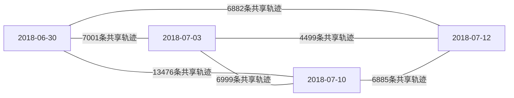

# M03：多日连接点网验收报告

日期：2026-11-09。本次只执行M03，未做M04光束法平差。M01/M02依赖已重新核验；M04–M08保持pending。

下游执行仓库：`/home/gengxun/code/hayabusa2-render-adapter-worktrees/m03`，分支`feat/m03-control-network`，提交`f1465231812523aaf85cc550a5ee3fd9d96dd439`。原master未改写，其dirty文件已完整快照。当前通用渲染器只承载规划、报告与登记，不混入任务数据或任务代码。

## 验收结果

| 项目 | 结果 |
|---|---:|
| 影像 | 276帧、4日 |
| 几何邻近影像对 | 1705 |
| 双向比值/RANSAC后匹配边 | 902402 |
| 三视几何过滤后、空间去重前轨迹 | 19712 |
| 移除空间重复轨迹 | 5777 |
| 最终拟合轨迹 | 11135 |
| 最终留出检查轨迹 | 2800 |
| 拟合网连通分量 | 1，包含全部276帧 |
| 单帧最少拟合/检查观测 | 537 / 122 |
| 面片ID支持数 | 11720 / 49152 |
| 同帧地标最小间距 | 1.503750 px |

面片ID支持数是点对应的面片计数，不是面积覆盖率，也不是反照率有效覆盖率。未观测区域仍为未知。轨迹日期覆盖：4日4481条、3日4798条、2日4462条、仅1日194条。

| 日期 | 帧数 | 每帧最少拟合观测 | 每帧最少检查观测 |
|---|---:|---:|---:|
| 2018-06-30 | 124 | 537 | 122 |
| 2018-07-03 | 13 | 555 | 133 |
| 2018-07-10 | 127 | 539 | 130 |
| 2018-07-12 | 12 | 562 | 129 |

## 日期间连接

边为同时出现在两个日期的保留轨迹数量；同一轨迹可贡献多个日期对，不能把边计数相加当独立轨迹数。



## 初始几何质量与边界

- 每轨迹重投影RMS中位数/P90：0.3681 / 0.6995 px。
- 每轨迹最大重投影残差中位数/P90：0.7003 / 1.5161 px；全网最大3.9728 px。
- 点到径向DSK锚点距离中位数/P90：2.2724 / 7.4049 m；最大29.6589 m。
- 固定门槛：至少3视、正深度、交会角>=1度、最大初始重投影<=4px、径向表面/first-hit偏离<=30m、DSK太阳可见且非掠入射。

这些是M03初始网诊断，不是最终定位精度。相机仍为输入SPICE位姿；检查点初始三角化坐标不是测量真值。M04须排除检查观测于拟合代价之外，并独立定义检查几何与最终精度。

网络使用zero-based主点511.5，renderer TSAI使用one-based512.5。六幅跨日方向/尺度探针支持(+sample,+line)，轮廓IoU约0.929–0.954；这不是亚像素配准验收。四日靶心相位角仅17.83–18.65度，不能据此宣称宽相位重照明泛化。

## 实现与修正

- 相机writer支持中心和姿态，TSAI R按既有渲染器合约写入J2000→相机逆旋转；修正旧测试把45度四元数期待为90度矩阵的问题。
- 输入I/F科学值不变；对比度、暗区和边界掩膜只用于几何特征。L2d已畸变校正，不能套原L2a畸变坐标。
- run-v1虽连通，但3960检查轨迹中1690条在某观测中距拟合地标<1.5px，源于SIFT多方向/尺度描述子；该运行未验收。
- run-v2先按整轨迹移除空间重复地标，再确定性分配拟合/检查角色。没有为通过验收放宽几何门槛。

## 验证与审阅

- 新鲜单元/集成测试：20 passed / 0 failed / 0 skipped（含本地真实SPICE）。
- 保存产物重读验证：8 passed / 0 failed / 0 skipped，覆盖结构与整轨迹留出、输入/相机来源、特征坐标、正深度/重投影/交会、DSK表面与首交/太阳遮挡、地标空间独立性、全帧覆盖和连通性。
- 独立只读代码审阅未发现critical/important问题；另用asp370重跑20测试通过，复核全部276个I/F哈希、实现哈希及确定性fit/check角色。
- 非阻塞建议：以后将当前额外核验的源I/F重哈希、角色确定性和全部诊断量核对纳入保存产物验证器。当前产物未发现对应缺陷。

## 产物和复现

- 验收运行：`outputs/ryugu-realism/m03/run-v2/`（特征、tracks、report、validation）。
- 规范产物：`outputs/ryugu-realism/m03/tracks.json`及`network-report.json`，为验收运行的普通文件副本，哈希一致。
- 源码Git bundle：`outputs/ryugu-realism/m03/adapter-source.bundle`；原始dirty文件快照另存source-snapshot。
- 原始影像、核、缓存和大网络JSON未入Git。

```bash
PYTHONPATH=/home/gengxun/code/hayabusa2-render-adapter-worktrees/m03/src \
/home/gengxun/miniconda3/envs/asp360_new/bin/python -m hayabusa2_adapter.control_network \
  --audit /home/gengxun/code/smallbody-renderer/outputs/ryugu-realism/m01/input-audit.json \
  --calibration /home/gengxun/code/smallbody-renderer/outputs/ryugu-realism/m02/calibration-manifest.json \
  --output /home/gengxun/code/smallbody-renderer/outputs/ryugu-realism/m03/reproduction
```

保存产物验算运行下游`hayabusa2_adapter.validate_network --run <新运行目录> --audit <上述审计文件> --calibration <上述标定文件>`；完整命令和依赖见下游README。源码远程地址尚未配置，已向用户询问，未擅自新建公开仓库；当前仓库PR仅发布规划、报告及登记，下游源码PR待远程端点。

## 下一里程碑

M04：固定形状与内参，带SPICE先验和有限精度表面约束优化位姿与拟合连接点，使用隔离检查观测验收。本次不激活或执行M04。
